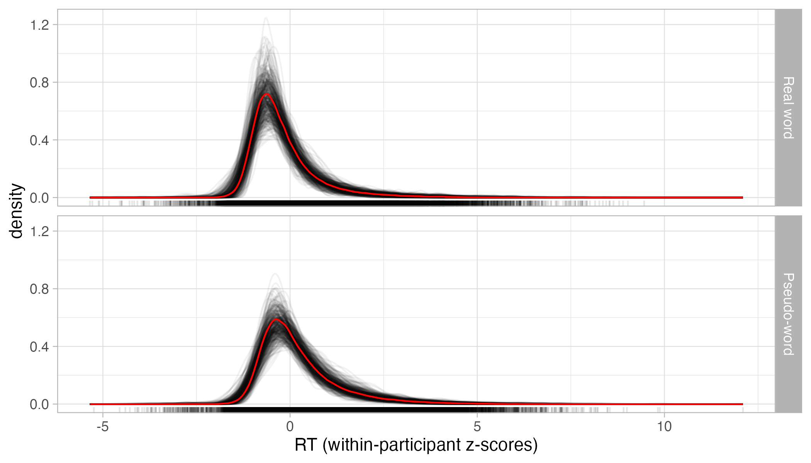
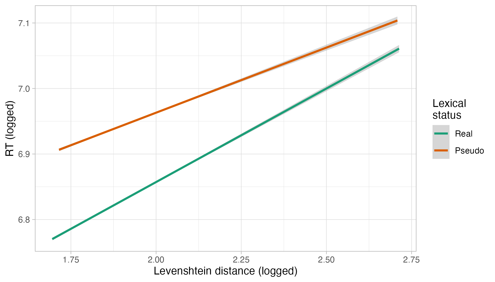

## Introduction

Bayesian analysis is increasingly becoming an established alternative to Null Hypothesis Significance Testing (NHST) within linguistics and language research XXX.
More and more research papers using Bayesian methods are being published across different sub-disciplines and more and more tutorials on how to conduct Bayesian analyses with linguistic data are becoming available XXX.
A variety of reasons behind the adoption of Bayesian inference can be put forward.
Just to mention a couple, Bayesian estimation based on Markov chain Monte Carlo methods affords us with models of greater complexity than what can be generally be successfully fitted with maximum likelihood estimation (like in popular packages like lme4 and XXX), and there is now a greater appreciation of methods that allow for more nuanced inferences than what the NHST method as currently implemented allows us to do, especially in light of the conversations around the reliability of empirical results in the published literature XXX.

While such quick adoption is very welcomed, much of the resources currently available have focussed on how to fit Bayesian models and considerably less attention has been given to the logic of inference after model fitting.
In our experience, we have informally observed an approach we call the Bayesian Null Ritual XXX, where the full potential of posterior probability distributions is not harnessed and researchers still rely on binary decisions on whether an effect of interest "exists".
In this paper, we provide linguists and language researchers with guidelines on how to use posteriors to make and communicate substantive inferences about their estimands of interest.

## Bayesian posterior probability distributions

## The Bayesian Null Ritual

## A worked out example

### The data

As an example on how to use posterior probabilities for inference, we will use data from @tucker2019.
The Massive Auditory Lexical Decision data set contains reaction times and accuracy data from an English lexical decision task performed by 440 participants.
We refer the reader to @tucker2019 for more information.
In this paper, we will focus on reaction times and two other variables: lexical status (whether the target word is real English word or a pseudo-word) and mean phoneme-level Levensthein distance.
Traditionally, the Levenshtein distance between two words counts how many operations are needed to obtain one word from the other (the operations are modifying, adding or deleting a character).
The phoneme-level Levenshtein distance between two words counts the number of operations applied to the phonemic representation of the word (rather than the graphemic string).
For each word in the data set, the phoneme-level Levenshtein distance between that word and each other word was calculated and the mean of those distances taken as the mean phoneme-level Levenshtein distance of that word.
In other words, the mean phoneme-level Levenshtein distance of a word is a measure of how unique that word is relative to the others in the data set: a higher mean distance indicates a more unique word (i.e. on average more operations are needed to change that word's phonemic representation to those of the other words).

For the purposes of illustration, we sampled 150 observations from 30 participants out of the 440.
We have also filtered the reaction times data to include only positive values (we assumed that negative RT values are errors).
@fig-rt-dens-isword shows the density plot of RTs, for real words (top panel) and pseudo-words (bottom panel).
In the figure, RTs were z-scored within each participant.
The two panels show densities of each individual participant (in black) and the overall density (in red).

{#fig-rt-dens-isword fig-align="center"}

@fig-rt-pl shows two regression lines with 95% CIs of logged Levenshtein distance and logged RTs in real (green) and pseudo-words (orange).
Overall, distance has a positive effect on RTs.
The regression line is steeper in real than in pseudo-words, thus suggesting a stronger effect of distance in real than in pseudo-words.

{#fig-rt-pl fig-align="center"}

## References
