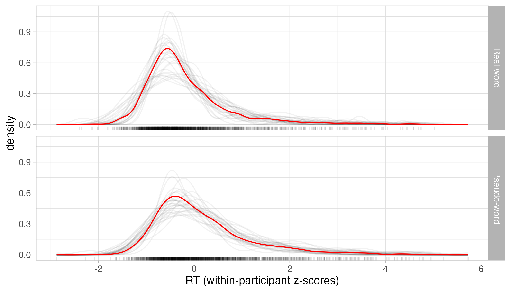
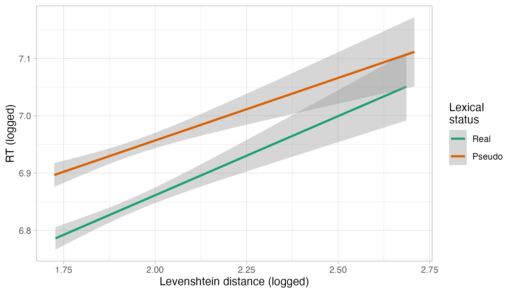

## Introduction

```{r}
#| label: setup
#| include: false

library(tidyverse)
theme_set(theme_light())
library(posterior)

```

Bayesian analysis is increasingly becoming an established alternative to Null Hypothesis Significance Testing (NHST) within linguistics and language research XXX.
More and more research papers using Bayesian methods are being published across different sub-disciplines and more and more tutorials on how to conduct Bayesian analyses with linguistic data are becoming available XXX.
A variety of reasons behind the adoption of Bayesian inference can be put forward.
Just to mention a couple, Bayesian estimation based on Markov chain Monte Carlo methods affords us with models of greater complexity than what can be generally be successfully fitted with maximum likelihood estimation (like in popular packages like lme4 and XXX), and there is now a greater appreciation of methods that allow for more nuanced inferences than what the NHST method as currently implemented allows us to do, especially in light of the conversations around the reliability of empirical results in the published literature XXX.

While such quick adoption is very welcomed, much of the resources currently available have focussed on how to fit Bayesian models and considerably less attention has been given to the logic of inference after model fitting.
In our experience, we have informally observed an approach we call the Bayesian Null Ritual XXX, where the full potential of posterior probability distributions is not harnessed and researchers still rely on binary decisions on whether an effect of interest "exists".
In this paper, we provide linguists and language researchers with guidelines on how to use posteriors to make and communicate substantive inferences about their estimands of interest.

## Bayesian posterior probability distributions

## The Bayesian Null Ritual

### 95% CrIs are not special

Current NHST practice is preoccupied with 95% Confidence Intervals (and relatedly on $\alpha = 0.05$).
This devotion continues despite the fact that both Fisher on the one hand and Neyman and Pearson on the other were against universal thresholds.
For example, Fisher stated that "no scientific worker has a fixed level of significance at which from year to year, and in all circumstances, \[they\] reject hypotheses; \[they\] rather gives \[their\] mind to each particular case in the light of \[their\] evidence and \[their\] ideas" [@fisher1956, p 42; @maier2022].
Even in Neyman and Pearson's work, a universal $\alpha$ level does not follow from the framework they propose.
In fact, Neyman says "\[t\]he first demand of the mathematical theory is to deduce such test criteria as would ensure that the probability of committing an error of the first kind would equal (or approximately equal, or not exceed) a preassigned number $\alpha$, *such as* $\alpha = 0.05$ or $0.01$, etc." [@neyman1976, p. 161, emphasis our own; @hubbard2003].
We can safely infer from the quote that those $\alpha$ values are merely suggestions, not mandated standards.
Furthermore, Neyman and Pearson clearly argue that "\[t\]he use of these statistical tools \[i.e. the statistical significance $\alpha$ and the statistical power $\beta$ together with their respective Type I and Type II errors\] in any given case, in determining just how the balance should be struck, must be left to the investigator." In other words, the researcher should decide how to balance Type I and Type II error rates by setting $\alpha$ and $\beta$ values in each individual case.

The loyalty of 95% as a standard threshold can now be seen, in our experience, in applied Bayesian statistics in linguistics, where it is common for researchers to focus on 95% Bayesian Credible Intervals (CrIs).
Bayesian posterior probability distributions, the hall-mark of Bayesian inference, allow researches for a more nuanced understanding of parameter estimation.
CrIs with different probability levels, such as 98, 80, 75 or 63, are as useful as a 95% CrI.
Each tells us what range of values contains a certain proportion of probability mass of the posterior probability distribution.
In this sense, there is no reason to prefer one probability level over another.
For example, imagine a posterior distribution like the one in @fig-cri-example. The *x*-axis is a (simulated) effect in log-odds of a variable *x* from a Bernoulli regression model of a binary outcome *y*, while the *y*-axis shows the density plot of the (simulated) draws of the effect.
The posterior probability distribution of the effect of *x* has a mean of 0.4 and an SD of 0.35 (log-odds).
@fig-cri-example includes coloured areas corresponding to the 60%, 80% and 95% CrIs of the posterior draws.
@tbl-cri-example reports the mean, SD and the 50-60-70-80-95% CrI of the corresponding odds ratio (i.e. the log-odds values are exponentiated before calculating the summary measures).

```{r}
#| label: fig-cri-example
#| fig-cap: ""
#| echo: false

set.seed(41956)
x <- rnorm(4000, 0.2, 0.15)

qs <- quantile(x, c(.025, .10, .2, .8, .90, .975))

density(x) |>
  with(tibble(x = x, y = y)) |>
  mutate(
    CI = case_when(
      between(x, qs[3], qs[4]) ~ "60%",
      between(x, qs[2], qs[5]) ~ "80%",
      between(x, qs[1], qs[6]) ~ "95%",
      .default = ">95%"
    ),
    CI = factor(CI, levels = c("60%", "80%", "95%", ">95%")),
    group = consecutive_id(CI)
  ) |>
  ggplot(aes(x, y, fill = CI, group = group)) +
  geom_area() +
  scale_fill_manual(
    values = c(
      "95%"  = "#bdd7e7",
      "80%"  = "#6baed6",
      "60%"  = "#2171b5",
      ">95%" = "grey90"
    ),
    breaks = c("60%", "80%", "95%")
  ) +
  labs(
    x = "Effect (log-odds)",
    y = "Density"
  )
```

```{r}
#| label: tbl-cri-example
#| tbl-cap: ""
#| echo: false

tibble(x = exp(x)) |> 
  summarise(
    mean = mean(x) |> round(2),
    sd = sd(x) |> round(2),
    `95%` = paste0("[", paste(quantile2(x, c(0.025, 0.975)) |> round(2), collapse = ", "), "]"),
    `80%` = paste0("[", paste(quantile2(x, c(0.1, 0.9)) |> round(2), collapse = ", "), "]"),
    `70%` = paste0("[", paste(quantile2(x, c(0.15, 0.85)) |> round(2), collapse = ", "), "]"),
    `60%` = paste0("[", paste(quantile2(x, c(0.2, 0.8)) |> round(2), collapse = ", "), "]"),
    `50%` = paste0("[", paste(quantile2(x, c(0.25, 0.75)) |> round(2), collapse = ", "), "]")
  )

```

For example, the 95% CrI of the odds ratio is 0.92-1.64, in other words there is a 95% probability that the change in probability is between 8% decrease to 64% increase relative to the baseline.
That is quite a wide range of odds ratios

## A worked out example

### The data

As an example on how to use posterior probabilities for inference, we will use data from @tucker2019.
The Massive Auditory Lexical Decision data set contains reaction times and accuracy data from an English lexical decision task performed by 440 participants.
We refer the reader to @tucker2019 for more information.
In this paper, we will focus on reaction times and two other variables: lexical status (whether the target word is real English word or a pseudo-word) and mean phoneme-level Levensthein distance.
Traditionally, the Levenshtein distance between two words counts how many operations are needed to obtain one word from the other (the operations are modifying, adding or deleting a character).
The phoneme-level Levenshtein distance between two words counts the number of operations applied to the phonemic representation of the word (rather than the graphemic string).
For each word in the data set, the phoneme-level Levenshtein distance between that word and each other word was calculated and the mean of those distances taken as the mean phoneme-level Levenshtein distance of that word.
In other words, the mean phoneme-level Levenshtein distance of a word is a measure of how unique that word is relative to the others in the data set: a higher mean distance indicates a more unique word (i.e. on average more operations are needed to change that word's phonemic representation to those of the other words).

For the purposes of illustration, we sampled 150 observations from 30 participants out of the 440.
We have also filtered the reaction times data to include only positive values (we assumed that negative RT values are errors).
@fig-rt-dens-isword shows the density plot of RTs, for real words (top panel) and pseudo-words (bottom panel).
In the figure, RTs were z-scored within each participant.
The two panels show densities of each individual participant (in black) and the overall density (in red).

{#fig-rt-dens-isword fig-align="center"}

@fig-rt-pl shows two regression lines with 95% CIs of logged Levenshtein distance and logged RTs in real (green) and pseudo-words (orange).
Overall, distance has a positive effect on RTs.
The regression line is somewhat steeper in real than in pseudo-words, thus suggesting a stronger effect of distance in real than in pseudo-words.

{#fig-rt-pl fig-align="center"}

We will address the following research question: *how does the effect of Levenshtein distance on reaction times differ depending on the lexical status of the target word?* To answer this question, we will fit a Bayesian regression model.

### The model

## References
